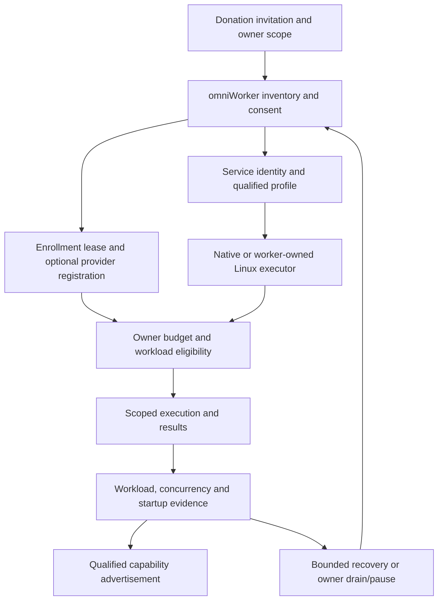

# Worker Onboarding Field Lessons Overview — Brainstorm

Status: brainstorm
Kind: reference
Summary: Apply the Windows Cloud PC setup lessons to the existing CPU-donation design while separating verified managed-host behavior from proposed public-donor capabilities.
Topics: worker-onboarding-lessons, worker-participation, donated-compute, worker-host-app, worker-readiness
Repository context: openXfactory owns the neutral lesson packet; omniWorker in OmniWorker-Install owns the host product and realization; policy and provider authority remain with their owners.
Captured: 2026-11-21

## Possible feats

- An omniWorker donation journey that replaces manual installation loops with scoped consent, service-owned execution and resumable reconciliation.
- Evidence-backed capacity advertisement across native Windows, Linux and multiple work sources, with distinct startup and workload acceptance gates.

## Motivation

The [worker-participation packet](worker-participation-overview.md) already
captures one openXfactory donation enrollment usable by eligible factories,
factory CI, separate direct GitHub registration and optional Linux capability.
This packet adds the operational lessons from setting up and migrating a
Windows Cloud PC runner. It links existing designs rather than creating another
worker product, broker or scheduler.

All documents here are non-normative design capture. Observations below concern
one managed host; proposed product behavior and public-donor trust remain
distinct from that pilot's acceptance.

## Existing ownership and design anchors

- The [omniWorker naming record](../../docs/omniworker-naming.md) assigns the
  host product to `opensoft/OmniWorker-Install`; historical staged material may
  still use its predecessor owner name.
- The [staged Worker Host App](../staging/worker-host-app/worker-host-app.md)
  already proposes reconciliation rather than scripts, identity establishment,
  credential custody and unattended operation.
- The [worker-enrollment contract](../../contracts/worker-enrollment/README.md)
  owns enrollment leases, estate-specific authentication and transient grants.
- The [worker-owned WSL design](omni-unattended-worker-wsl2-worker-owned-distro.md),
  [aggregate budget](omni-unattended-worker-aggregate-budget-and-owner-controls.md)
  and [volunteer credential boundary](omni-unattended-worker-credential-reach-and-contribution-repository.md)
  remain the corresponding design authorities at their stated lifecycle status.

## Case checkpoint: 2026-11-21

This is a dated setup checkpoint, not a live fleet inventory. Sanitized operator
receipts and private organization CI establish the following boundaries:

| Claim | Checkpoint evidence |
|---|---|
| Managed host | 8-vCPU/32-GiB Windows Cloud PC; roughly 16 GiB visible in the worker's WSL environment |
| Existing endpoints | Two factory-oriented Windows registrations, one general Windows CI registration and one Linux CI registration: four total |
| Service ownership | Linux runner migrated to a dedicated non-administrator Windows account, with its own profile, and a non-root Linux service account |
| Execution | Private-repository smoke passed checkout, Python/workspace execution, expected identities and actual two-CPU/8-GiB limits |
| Broader workload | A full platform-validation head passed with a job-local Python loader correction and preserved validation gates |
| Additional slots | Three new Linux slots requested; installer and a conservative shared-budget design prepared, enrollment/concurrency not reported complete |
| Maintenance | Existing Linux registration moved into a group with no repository access; its assigned job passed and the runner drained to idle; expansion and release remained held |
| Observation | A running child job was omitted by an in-progress-only workflow scan because its parent reported queued; direct job readback corrected the diagnosis |
| Completion scope | A later "Ready" report referred to prior single-runner setup; user clarification and live inventory established that the three-slot installer had not run |
| Cold startup | Boot-triggered service-account startup configured and session-0 execution observed; reboot without sign-in not yet qualified |
| Administration | Private SSH/Headscale connectivity was a separate unfinished capability; outbound GitHub CI did not depend on it |

The managed pilot used approved private-organization runner access and
long-lived services. It did not prove deployment of the public donation
website, global allocation service, volunteer enrollment broker, ephemeral
attempt isolation or secret-safe private workloads on volunteer hardware.

## Goals and non-goals

The goal is to make those lessons usable when realizing the existing donation
design: inventory truthfully, obtain the right consent, establish service-owned
execution, hand off only scoped authority, recover known partial states, bound
shared resources, and report precisely what passed.

This packet does not ratify contract changes, implement the host app or website,
authorize hardware takeover, change workstation-intake policy, promote the
pilot's private runner group into a donation default, or claim the pending
four-slot/reboot acceptance. It does not replace independent output acceptance.

## System model

The arrows describe required composition, not deployed interfaces. In
particular, independently scheduled direct GitHub work still needs actual
admission coordination or an accounted partition.

## Cluster map and document map

The [donor-enrollment synthesis](worker-onboarding-lessons-synthesis-donor-enrollment.md)
connects five mechanisms:

- [Donor entry and registration choices](worker-onboarding-lessons-donor-entry-and-registration.md).
- [Service identities and execution tools](worker-onboarding-lessons-service-identities-and-tools.md).
- [WSL ownership and unattended startup](worker-onboarding-lessons-wsl-ownership-and-startup.md).
- [Scoped enrollment and credential handoff](worker-onboarding-lessons-credential-handoff.md).
- [Recoverable worker bootstrap](worker-onboarding-lessons-recoverable-bootstrap.md).

The [operation and acceptance synthesis](worker-onboarding-lessons-synthesis-operation-and-acceptance.md)
connects startup/recovery with:

- [Measured capacity and logical work slots](worker-onboarding-lessons-aggregate-capacity.md).
- [Capability qualification and CI portability](worker-onboarding-lessons-qualification-and-portability.md).
- [Maintenance admission and safe fleet expansion](worker-onboarding-lessons-maintenance-admission.md).
- [Job-level observation and conflicting provider state](worker-onboarding-lessons-job-observability.md).

The nine atoms, two syntheses and this overview form one linked supplement to
the original participation packet.

## Decisions still open

Choose the first public contribution adapter and invitation flow, realize the
existing lease/broker boundary, define supported host builds and containment
classes, bind capacity to enforceable controls, and select evidence expiry and
recovery contracts. Credential custody must respect estate policy. The app
should expose these choices as qualified behavior, not derive authority or
performance guarantees from a successful manual managed-host setup.
