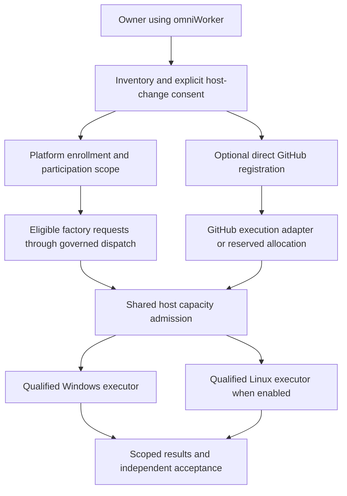

# Synthesis: Worker Onboarding and Governed Dispatch — Brainstorm

Status: brainstorm
Kind: architecture
Summary: Connect independent registration choices, capability-led onboarding, shared donation and aggregate admission without replacing existing execution trust gates.
Topics: worker-participation, worker-enrollment, clearing-dispatch, ci-execution, aggregate-budget
Repository context: openXfactory defines neutral seams; omniWorker owns the host; factory and GitHub integrations retain their own dispatch authority.
Captured: 2026-11-20

## Possible feats

- A single owner journey from inventory to a qualified, consented contribution.
- Cross-factory CI and other work within a standing donation scope.
- Consistent admission across factory requests and direct GitHub execution.

## Composition

The [registration boundaries](worker-participation-registration-boundaries.md)
separate the owner's relationships from the execution adapter. The
[onboarding flow](worker-participation-capability-onboarding.md) discovers which
environments can actually execute work. The [shared network pool](worker-participation-shared-network-pool.md)
defines who may request the offered capacity. The [host admission model](worker-participation-shared-host-admission.md)
determines whether a particular attempt can start now. None of those decisions
substitutes for another.

Arrows express required coordination, not an implemented transport. In
particular, the GitHub adapter needs actual coordination or reserved capacity;
the diagram does not confer local control over GitHub's scheduler.

## End-to-end authority handoff

1. The owner consents to host changes, participation scope and resource limits.
   Managed deployment supplies its applicable fleet authority through the
   existing managed route.
2. Enrollment establishes an installation identity and renewable worker
   authority. Direct GitHub registration, if selected, is separately authorized.
3. Qualified probes advertise environment capabilities and their freshness.
   Linux eligibility appears only after the selected executor is ready.
4. An eligible factory submits a CI or other supported work request. Its
   authority is intersected with standing donation consent and trust policy.
5. Dispatch applies input-release and containment gates, reserves capacity and
   leases an attempt. The host executes only within that authorization.
6. Results retain attempt and source-revision provenance for independent
   acceptance. Resource release, lease renewal and owner controls reconcile
   with actual execution state.

The existing [governed dispatch](omni-unattended-worker-synthesis-governed-dispatch.md)
and [sandboxed execution](omni-unattended-worker-synthesis-sandboxed-execution.md)
syntheses remain the foundation. This composition adds participation semantics
and documents their tension with GitHub-specific enrollment fields; it does
not ratify a replacement scheduler, enrollment protocol or containment profile.

## Decisions needed before realization

Choose the first CI adapter and result contract, resolve the enrollment and
workstation-intake deltas, assign shared-pool runtime ownership, and qualify
host admission with direct GitHub work. Selected-factory and mixed allocation
modes are options to evaluate. The [overview](worker-participation-overview.md)
records coverage and the distinction between user requirements and these open
design choices.
